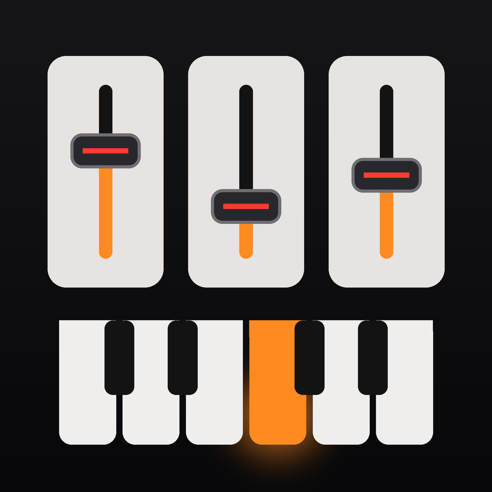
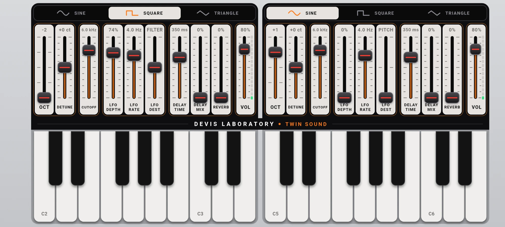

<p align="center">
  
</p>

# Twin Sound

**A two-in-one synthesizer for your phone, by Devis Laboratory.**
The keyboard is split in half and each half is a complete, independent synth — so you can play a sine bass with your left hand and a square lead with your right.

<p align="center">
  
</p>

Built for **AI Challenge – Day 7**, together with an AI coding assistant.

## Features

- **Two independent synths** — every keyboard half has its own sound and its own settings
- **Per half:** octave (−2…+2) · wave shape switch (**sine / square / triangle**) · detune · filter cutoff · LFO (depth, rate, destination: pitch / filter / volume) · delay (time, mix) · reverb · volume with a live level meter
- **Polyphonic** (16 voices per half), multi-touch, glissando, velocity from the touch position on the key
- **Click-free controls** — every slider is smoothed on the audio thread (no zipper noise)
- **Settings are remembered** between launches
- Minimal hardware-style UI drawn entirely in code (inspired by the OP-1 and black-panel / light-tile sampler designs), landscape only

## How it works

| Layer | What | Where |
|---|---|---|
| UI | Flutter, Provider, custom painters (sliders, keys, switch) | `lib/ui/` |
| State | Per-half patch + octave, persisted as JSON | `lib/state/`, `lib/services/` |
| Bridge | `dart:ffi` bindings; the C++ library is built by a Dart [native-assets](https://dart.dev/tools/hooks) hook | `lib/core/audio/`, `hook/build.dart` |
| Audio engine | C++ DSP: oscillators (PolyBLEP square), TPT state-variable filter, ADSR, LFO, stereo delay and a Freeverb-style reverb, soft limiter | `src/synth.cpp` |
| Audio output | [miniaudio](https://miniaud.io) in low-latency mode | `src/miniaudio_impl.cpp` |

Why no isolate in the audio path: the audio thread is owned by miniaudio. A key press calls a leaf FFI function that only pushes an event into a lock-free ring buffer; the audio thread never allocates, locks, or calls into Dart.

Loudness note: a square and a sine of equal RMS do not *sound* equally loud, so the square is turned down (~8 dB) and the sine/triangle get a few quiet upper partials so they are not muffled. The numbers live in `src/synth.cpp` (`waveGain`, `kAir`).

## Run

```bash
flutter pub get
flutter run            # pick an Android device or macOS
```

No manual NDK / CMake / Xcode setup is needed: the C++ engine is compiled automatically for the target platform.

```bash
flutter test           # native DSP tests (offline rendering) + UI / multi-touch tests
```

To regenerate the icon and splash after editing `tools/make_icons.py`:

```bash
python3 tools/make_icons.py
dart run flutter_launcher_icons
dart run flutter_native_splash:create
```

## Status

Developed and tested on **Android** (Samsung, arm64) and **macOS**. The iOS, Windows and Linux targets are configured but have not been built or tested.

## Project layout

```
hook/build.dart         native build hook (compiles src/*.cpp)
src/                    C++ synth engine + miniaudio
lib/core/audio/         FFI bindings, SynthEngine (native / null)
lib/models/             SynthParam, PatchConfig, note helpers
lib/state/              SynthState, AudioMonitor
lib/services/           SettingsStore (JSON persistence)
lib/ui/                 screens and widgets (sliders, keyboard, wave switch)
test/                   native DSP, UI and settings tests
```

---

© Devis Laboratory
